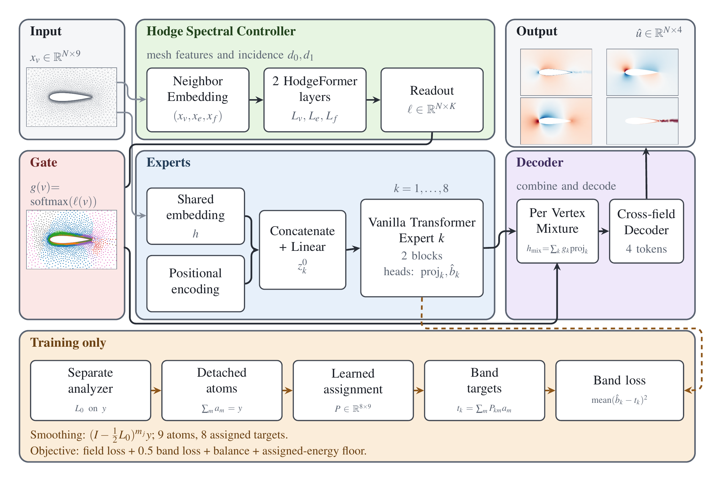
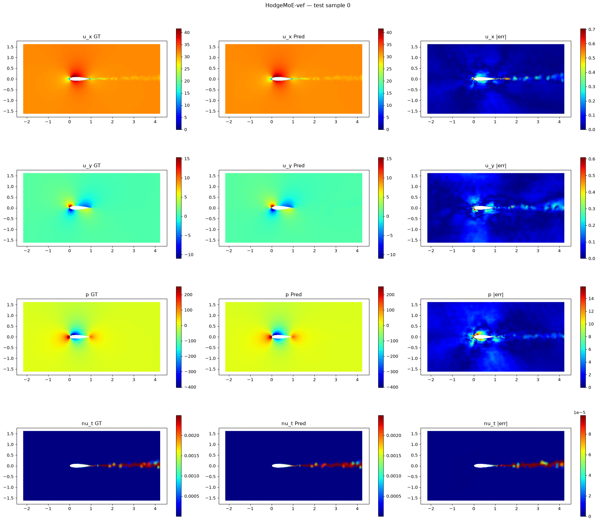

# Learnable Hodge–Laplacian Driven Mixture of Experts for Steady-PDE Surrogates on Coarse Unstructured Meshes

**HodgeMoE** predicts steady flow fields on unstructured meshes using a geometry-aware mixture of transformer experts. A Hodge–Laplacian controller reads the mesh and assigns an expert mixture to each vertex. Eight transformer experts use different Fourier positional scales, while multiscale auxiliary supervision encourages them to capture different components of the solution.

**Stavros Nousias · Akis Nousias · Konstantinos Gkrispanis**
Technical University of Munich · K3Y Labs

[Method](#method) · [Paper results](#paper-results) · [Released checkpoint](#released-checkpoint) · [Getting started](#getting-started) · [Training](#training) · [Documentation](#documentation)



*Architecture figure from the paper. The diagram presents the vertex, edge, and face extension. The paper's headline model uses vertex-only routing; this repository releases a checkpoint of the extension.*

## Overview

Steady flow solutions combine smooth far-field behavior with sharp changes near walls and wakes. HodgeMoE combines expert representations at each vertex using routing weights computed from mesh geometry and connectivity.

The experiments use **AirFRANS**, a benchmark of steady Reynolds-averaged Navier–Stokes flow around airfoils. The model predicts four fields on remeshed domains with approximately **4,900 vertices and 9,600 triangular faces**:

| Output | Meaning |
|---|---|
| $u_x$, $u_y$ | Velocity components |
| $p$ | Pressure |
| $\nu_t$ | Turbulent kinematic viscosity |

The paper's main model achieves **0.0300 mean relative $L_2$ error**, with **31% lower relative $L_2$ error** and **47% lower interior MSE** than Transolver on the working meshes, using approximately half as many parameters. Transolver retains lower surface and lift errors. Training and checkpoint-selection protocols differ, as described below.

**Release scope.** This repository contains the **vertex, edge, and face (VEF) routing variant**, its training and evaluation code, normalization statistics, and a **400-epoch checkpoint**. That checkpoint achieves **0.0329 mean relative $L_2$ error**. It is a separate run from both the paper's headline vertex-only model and its supplementary VEF experiment.

## Method

### Mesh-aware routing and transformer experts

The prediction path has four components:

1. **Shared embedding.** Each vertex is represented by nine inputs: coordinates, dual area, inlet velocity, signed distance, wall normals, and a wall indicator.
2. **Hodge controller.** Two HodgeFormer layers use mesh features and signed incidence matrices to produce eight routing logits per vertex. A softmax converts these logits into mixture weights.
3. **Transformer experts.** Eight experts combine the shared embedding with fixed Fourier positional features at different scales. Each expert produces a latent representation and an auxiliary field prediction.
4. **Field decoder.** The weighted sum of expert representations passes through a decoder with attention across the four output fields.

$$
g_k(v)=\mathrm{softmax}_k(\ell(v)),\qquad
h_{\mathrm{mix}}(v)=\sum_{k=1}^{8}g_k(v)\,\mathrm{proj}_k(z_k(v)).
$$

The controller supplies the mixing weights; the experts fit the fields. All eight experts run for every mesh. This is a dense mixture with global attention within each expert.

### Multiscale supervision

During training, a separate vertex Hodge Laplacian smooths the reference fields at eight diffusion depths. Differences between successive smoothings form **nine telescoping atoms** whose sum reconstructs the target. A learned column-normalized assignment groups them into eight expert supervision targets, which also sum to the original field.


*Reference pressure decomposition from the paper, illustrating smooth and finer-scale components. The training analyzer uses nine overlapping atoms and a learned assignment; these are not orthogonal frequency bands.*

The objective combines interior and wall prediction losses, auxiliary band supervision, a penalty against collapsed routing, and an energy floor for underused bands. The analyzer is used only during training. Its atoms are detached before assignment, so the conductance network remains at initialization while the assignment learns.

### Routing variants

The paper's main controller updates vertex features using a vertex Hodge operator. The VEF extension in this repository additionally computes edge and face updates:

| Stream | Operator |
|---|---|
| Vertices | $L_0$ |
| Edges | $L_1^{\mathrm{down}}+L_1^{\mathrm{up}}$ |
| Faces | $L_2^{\mathrm{down}}$ |

Here, **VEF means vertices, edges, and faces**. The controller reads out the final vertex stream to route the experts. See [architecture and implementation details](docs/ARCHITECTURE.md) for the operator definitions and an audit of which updates affect the output.

## Paper results

The following values reproduce the paper's main comparison on the official **800 training / 200 test** split. All models are evaluated against interpolated CFD targets on the same approximately 4,900-vertex working meshes.

| Model | Parameters | Mesh use | rel-$L_2$ ↓ | $R^2$ ↑ | Volume ↓ | Surf ↓ | $C_L$ error ↓ | $\rho_L$ ↑ |
|---|---:|---|---:|---:|---:|---:|---:|---:|
| **Hodge-routed MoE** | **3.02M** | Router | **0.0300** | **0.9983** | **0.00140** | 0.00164 | 0.0225 | 0.99988 |
| Transolver | 6.00M | None | 0.0436 | 0.9953 | 0.00265 | **0.00143** | **0.0103** | **0.99989** |
| PointNet | 0.08M | None | 0.0689 | 0.9904 | 0.00451 | 0.00440 | 0.0149 | 0.99965 |
| Pointwise MLP | 0.02M | None | 0.1743 | 0.9404 | 0.03576 | 0.03969 | 0.0860 | 0.99338 |
| PSD-star HodgeFormer | 0.47M | Prediction operator | 0.0800 | 0.9885 | 0.01028 | 0.01048 | 0.0681 | 0.99883 |

**Metrics.** Relative $L_2$ and $R^2$ are evaluated in physical units and averaged across the four fields. Volume and Surf are AirFRANS-style globally normalized MSE on non-wall and wall vertices. $C_L$ error is the relative error of mesh-native lift across the test cases; $\rho_L$ is its Spearman correlation.


*Pressure (top) and turbulent viscosity (bottom), with shared reference color scales. Left to right: CFD reference; (a) Hodge-routed MoE; (b) Transolver; (c) PointNet; (d) PSD-star HodgeFormer. This figure belongs to the paper's comparison, rather than evaluation of the checkpoint packaged here.*

The largest per-field gain over Transolver is in turbulent viscosity: relative $L_2$ decreases from **0.1158 to 0.0629**, approximately **46%**.

| Model | $u_x$ rel-$L_2$ ↓ | $u_y$ rel-$L_2$ ↓ | $p$ rel-$L_2$ ↓ | $\nu_t$ rel-$L_2$ ↓ |
|---|---:|---:|---:|---:|
| **Hodge-routed MoE** | **0.0056** | 0.0259 | **0.0255** | **0.0629** |
| Transolver | 0.0067 | **0.0220** | 0.0298 | 0.1158 |
| Learned-band MoE | 0.0068 | 0.0288 | 0.0365 | 0.0658 |
| Fixed-band MoE | 0.0068 | 0.0312 | 0.0346 | 0.0679 |

Selected ablations from the paper's supplementary comparison:

| Configuration | Parameters | rel-$L_2$ ↓ | Volume ↓ | Surf ↓ |
|---|---:|---:|---:|---:|
| Hodge-routed MoE, vertex-only | 3.02M | **0.0300** | **0.00140** | **0.00164** |
| Hodge-routed MoE, wider experts | 5.68M | 0.0341 | 0.00163 | 0.00219 |
| Hodge-routed MoE, VEF router | 3.11M | 0.0359 | 0.00182 | 0.00180 |
| Learned-band MoE | 2.75M | 0.0345 | 0.00165 | 0.00192 |
| Fixed-band MoE | 2.75M | 0.0351 | 0.00178 | 0.00184 |
| Wide plain transformer | 2.72M | 0.0446 | 0.00265 | 0.00192 |

**Experimental context.** The paper reports one run per configuration. HodgeMoE trains on all 800 training cases and selects checkpoints using test-set error; the baselines reserve 80 training cases for validation and use validation-based selection. The paper's VEF run also changes the edge support cap and adds a 200-epoch continuation. These differences limit attribution of gains to architecture alone. Results concern the coarse working meshes, and do not establish accuracy at the original CFD resolution.

## Released checkpoint

The supplied checkpoint, [`hodgemoe_vef_best_ep400.pth`](checkpoints/hodgemoe_vef_best_ep400.pth), contains **3,106,490 parameters** and was trained for **400 epochs in fp32**. Its normalization statistics are included in [`norm_stats.npz`](checkpoints/norm_stats.npz).

| Metric | This checkpoint |
|---|---:|
| Mean relative $L_2$ | **0.0329** |
| Mean $R^2$ | 0.9981 |
| Volume | 0.00170 |
| Surf | 0.00202 |
| Mesh-native $C_L$ relative error | 0.0313 |
| Lift Spearman correlation | 0.9999 |

These values come from evaluating the supplied checkpoint on all 200 official test cases. The final epoch also has the lowest mean relative $L_2$ in this run's 20-checkpoint sweep. The paper's supplementary VEF value, **0.0359**, comes from a different run selected at epoch 560.



*Evaluation of the checkpoint included here. Rows: $u_x$, $u_y$, $p$, $\nu_t$. Columns: reference, prediction, absolute error. Fields are shown in physical units.*

See [complete release results](docs/RESULTS.md), [evaluation arrays and logs](docs/eval_release/), and [checkpoint provenance](checkpoints/PROVENANCE.md).

## Getting started

### Install

From the repository root:

```bash
conda env create -f environment.yml
conda activate hodgemoe-vef
pip install -e third_party/mesh_opformer -e third_party/mesh_sim -e third_party/mesh_opformer_geodesic
```

The supplied [environment](environment.yml) specifies Python 3.12 and pins the training dependencies, including PyTorch 2.14.1. The release was trained on one NVIDIA RTX 4090. For CPU execution, set `device = "cpu"` in [`config.toml`](config.toml); execution will be substantially slower.

### Prepare the data

Place the preprocessed AirFRANS mesh pool under `dataset/processed_augmented/`. Follow the [dataset README](dataset/README.md) for contents, placement, and optional raw-data setup. **The Dropbox shared download link is pending.** Existing checkouts may already contain the pool.

```text
dataset/
├── processed_augmented/   # 6,600 mesh files + target statistics, ~1.2 GB
├── cached/                # generated automatically
│   ├── train_geo/
│   └── test_geo/
└── original/              # optional raw AirFRANS simulations
```

`[data] data_root = "dataset"` in `config.toml` controls the mesh-pool location. Relative data and cache paths resolve against the repository root. If data lives elsewhere, set `data_root` to its absolute path; the explicitly configured training and test `cache_dir` values remain independent and can also be changed.

The pool contains eight meshes per training case and one per test case. Geometry caches are built on first use and require approximately **20 GB for evaluation** and **251 GB for training**. Initial cache construction takes about a minute per mesh with the supplied Python geometry path; subsequent runs reuse it. Downloaded data and generated caches are covered by [`dataset/.gitignore`](dataset/.gitignore).

### Evaluate

```bash
bash scripts/run_eval.sh
```

This evaluates field accuracy and mesh-native lift, saves qualitative plots, and writes outputs under `runs/eval/`. Confirm that the console reports **200 test samples**.

To evaluate a different checkpoint or produce more plots:

```bash
CKPT=checkpoints/hodgemoe_vef_best_ep400.pth \
STATS=checkpoints/norm_stats.npz \
OUT=runs/eval_custom N_QUAL=8 bash scripts/run_eval.sh
```

The two evaluation steps can also be run directly:

```bash
python eval_fields.py --cfg_path config.toml \
    --ckpt checkpoints/hodgemoe_vef_best_ep400.pth \
    --stats checkpoints/norm_stats.npz --out runs/eval/fields --n_qual 8

python eval_lift.py --cfg_path config.toml \
    --ckpt checkpoints/hodgemoe_vef_best_ep400.pth \
    --stats checkpoints/norm_stats.npz --out runs/eval/lift
```

## Training

```bash
# Launch detached; logs and checkpoints go to runs/train/.
bash scripts/run_train.sh

# Alternatively, train in the current shell.
FOREGROUND=1 bash scripts/run_train.sh
```

The default recipe uses AdamW, a peak learning rate of $10^{-3}$, weight decay $10^{-4}$, and a 400-epoch OneCycle schedule. It trains in fp32 with **one mesh per batch**. Keep `batch_size = 1`: the current model treats the vertices as one mesh sequence. The released run took roughly 44 hours of wall time, including restarts and periods of shared GPU use.

Resume a run using its checkpoint and normalization statistics:

```bash
RESUME=runs/train/<checkpoint>.pth bash scripts/run_train.sh
```

The script restores the optimizer and scheduler and continues the existing schedule. Set `OUT` when resuming a run stored outside `runs/train/`. Optional Weights & Biases logging is configured in `config.toml`.

To evaluate saved checkpoints:

```bash
RUN=runs/train bash scripts/sweep_eval.sh
```

This sweep uses the official test set. Its scores should be interpreted with that selection protocol in mind. The supplied release's final checkpoint is also its best by mean relative $L_2$.

To regenerate the mesh pool from raw AirFRANS, follow [`scripts/generate_dataset/README.md`](scripts/generate_dataset/README.md). Regeneration is optional when the preprocessed pool is available.

## Reproducibility and implementation limits

The release preserves the architecture and training behavior that produced the checkpoint. Important implementation details are documented in the [architecture audit](docs/ARCHITECTURE.md):

- **Spectral guarantees are conditional.** Neighborhood truncation can break reciprocity, so the deployed controller does not enforce the symmetry needed for the intended positive-definite star construction. Prediction accuracy does not validate that guarantee.
- **Some modules do not update.** The checkpoint audit identifies 179,913 parameters without optimizer updates, including face-update paths that cannot reach the two-layer vertex readout, an unused alternative gate, and the analyzer conductance network.
- **Lift uses a wall-band estimator.** The mesh-native pressure integral is approximately twice the physical AirFRANS lift in the documented comparison. Its error supports comparisons under the same estimator; it should not be quoted as an absolute physical lift coefficient.
- **Attention cost grows with mesh size.** Every expert runs, and global attention scales quadratically in the number of vertices.
- **Single-run evidence has limits.** The fixed seed and pinned environment support reproduction, but CUDA reductions do not guarantee bitwise-identical results over a full training run.

## Documentation

| Path | Contents |
|---|---|
| [`config.toml`](config.toml) | Data paths, architecture, losses, optimizer, and schedule |
| [`arch/`](arch/) | Hodge controller, transformer experts, analyzer, and model |
| [`data/`](data/) | Dataset loader, geometry caching, and lift weights |
| [`training/`](training/) | Training loop, losses, metrics, and schedules |
| [`evaluation/`](evaluation/) | Field and mesh-native lift evaluation |
| [`diagnostics/`](diagnostics/) | Analyzer, routing, operator, and expert checks |
| [`dataset/README.md`](dataset/README.md) | Data setup and mesh-pool details |
| [`manifest/`](manifest/) | Official AirFRANS split |
| [`third_party/`](third_party/) | Vendored mesh packages |
| [`docs/ARCHITECTURE.md`](docs/ARCHITECTURE.md) | Operator definitions and implementation audit |
| [`docs/RESULTS.md`](docs/RESULTS.md) | Release metrics, per-field errors, and checkpoint sweep |
| [`checkpoints/PROVENANCE.md`](checkpoints/PROVENANCE.md) | Checkpoint origin, training history, and checksum |
| [`docs/paper/`](docs/paper/) | Figures reproduced from the paper |

## Paper

**Learnable Hodge–Laplacian Driven Mixture of Experts for Steady-PDE Surrogates on Coarse Unstructured Meshes**
Stavros Nousias, Akis Nousias, and Konstantinos Gkrispanis.

The method description, paper result tables, and figures above follow the supplied manuscript and supplementary material. The released checkpoint's results are documented separately with their evaluation artifacts.

## License

The repository is released under the [MIT License](LICENSE). AirFRANS has its own dataset license and citation requirements; consult the [AirFRANS documentation](https://airfrans.readthedocs.io).
