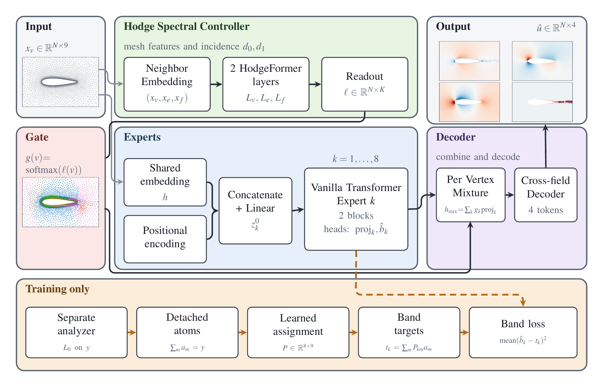
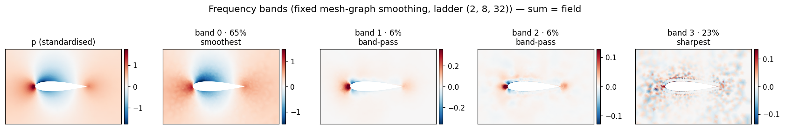
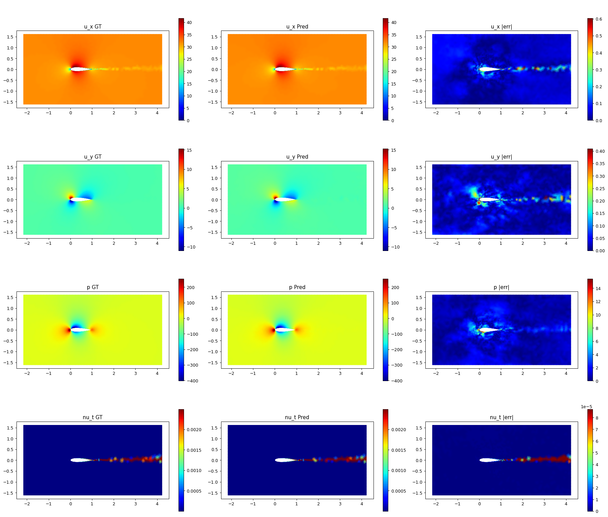
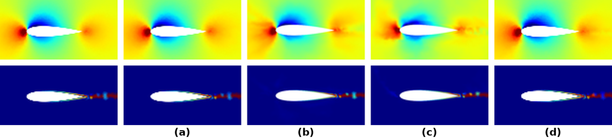
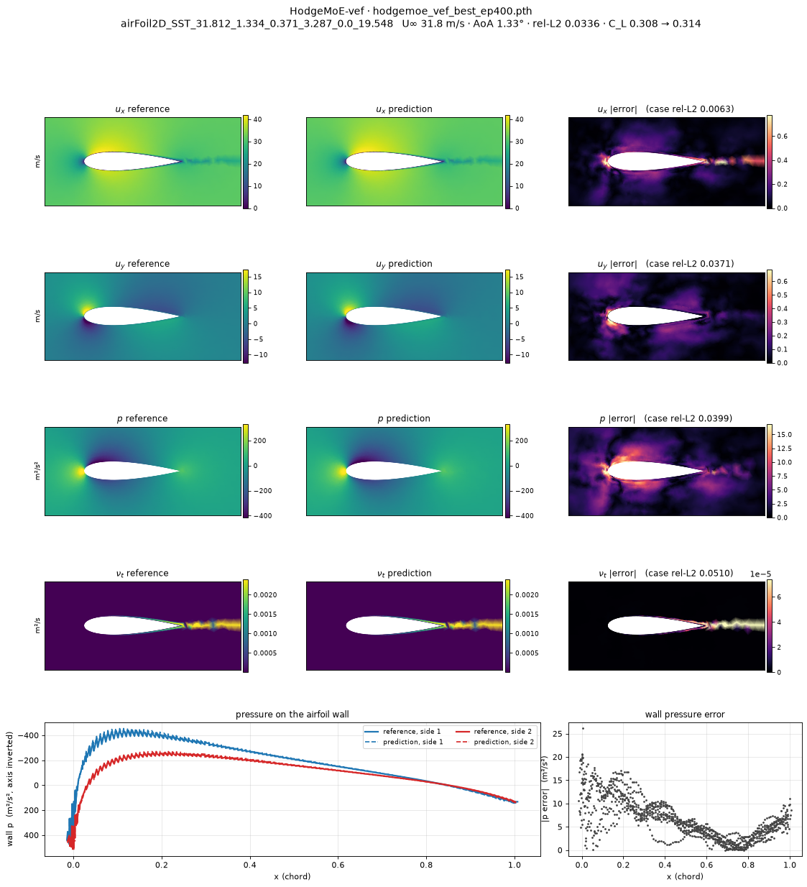

# Learnable Hodge–Laplacian Driven Mixture of Experts for Steady-PDE Surrogates on Coarse Unstructured Meshes

> [!WARNING]
> **This repository is under construction.**


**Stavros Nousias · Akis Nousias · Konstantinos Gkrispanis**
Technical University of Munich · K3Y Labs

**Paper:** [arXiv:2610.20585](https://arxiv.org/abs/2610.20585) · [Read the PDF](https://arxiv.org/pdf/2610.20585)

[Quick start](#quick-start) · [Abstract](#abstract) · [Methodology](#methodology) · [Experiments](#experiments) · [Released checkpoints](#released-checkpoints) · [Getting started](#getting-started) · [Verification](#verification) · [Training](#training) · [Layout](#repository-layout) · [Documentation](#documentation) · [Citation](#citation)

## Quick start

**1. Get the code and the environment.**

```bash
git clone https://github.com/snousias/hodge-moe-pde.git
cd hodge-moe-pde
conda env create -f environment.yml
conda activate hodgemoe-vef
pip install -e third_party/mesh_opformer -e third_party/mesh_sim -e third_party/mesh_opformer_geodesic
```

**2. Download the dataset.** The preprocessed AirFRANS mesh pool is published on Hugging Face at [snousias/hodge-moe-pde-airfrans](https://huggingface.co/datasets/snousias/hodge-moe-pde-airfrans) (five tar shards, about 1.2 GB, ODbL). One command downloads it, verifies the SHA-256 checksums and unpacks it into `datasets/processed_augmented/`:

```bash
bash datasets/download.sh      # expects 6,601 files when done
```

`wget` or `curl` is required. The [dataset README](datasets/README.md) gives the manual commands and the optional raw AirFRANS download.

**3. Evaluate the released checkpoints.** Both checkpoints are included in `checkpoints/`.

```bash
bash scripts/run_eval.sh                 # VEF checkpoint -> runs/eval/
VARIANT=v bash scripts/run_eval.sh       # V checkpoint (paper headline) -> runs/eval_v/
bash scripts/run_full_eval.sh            # both checkpoints, every test case, per-case + overall metrics -> runs/full_eval/
bash scripts/run_verify.sh               # evaluate and check against the reference metrics (exit 0 = PASS)
```

The first evaluation builds the test-geometry cache in `datasets/cached/test_geo/` (about a minute per mesh, 200 meshes, about 8 GB); later runs reuse it and take about 2 minutes per checkpoint on one RTX 4090.

**4. Train (optional).**

```bash
bash scripts/run_train.sh                # VEF configuration -> runs/train/
VARIANT=v bash scripts/run_train.sh      # vertex-only configuration -> runs/train_v/
```

Training builds a training-geometry cache of about 251 GB and runs for roughly 15 hours (V) to 44 hours (VEF) on one RTX 4090. Details are in [Getting started](#getting-started), [Verification](#verification) and [Training](#training).




*Overview of the model. The Hodge controller routes transformer experts that combine shared embeddings with positional encodings at different frequency scales. Their representations are mixed and decoded into four fields. During training, a separate analyzer decomposes the reference fields into atoms, which a learned assignment combines into targets for the auxiliary expert heads (dashed path).*

## Abstract

Surrogate models for steady partial differential equations on unstructured meshes often apply a single mixing mechanism to the whole solution. We propose a mixture of experts architecture supervised at different spectral scales. A controller that utilizes learnable Laplacian matrices, referred to as Hodge Controller, receives the mesh geometry and input features and produces per-vertex weights that combine the expert feature vectors. During training, a separate discrete Laplacian $L_0=\star_0^{-1}d_0^{\top}\star_1 d_0$ decomposes the reference fields into scale-dependent targets for auxiliary expert heads. We evaluate the model on AirFRANS, a steady Reynolds-averaged Navier–Stokes (RANS) airfoil benchmark, using remeshed triangular grids with approximately $9.6$k faces and $4.9$k vertices. On the official $800/200$ split, our model achieves $31\%$ lower relative $L_2$ error and $47\%$ lower interior mean squared error than Transolver on the same evaluation meshes, with approximately half as many parameters. Training allocations and checkpoint-selection procedures differ between our model and the baselines.

**Release scope.** This repository contains the training and evaluation code, normalization statistics, and two checkpoints:

- **Vertex-only ($V$) routing**, [`hodgemoe_v_best_ep380.pth`](checkpoints/hodgemoe_v_best_ep380.pth), 3,023,962 parameters, epoch 380, **0.0300 mean relative $L_2$ error**. This is the checkpoint behind the paper's headline $V$ row.
- **Vertex, edge, and face (VEF) routing**, [`hodgemoe_vef_best_ep400.pth`](checkpoints/hodgemoe_vef_best_ep400.pth), 3,106,490 parameters, epoch 400, **0.0329 mean relative $L_2$ error**. This is a separate run from the paper's supplementary VEF experiment, which reports 0.0359 at epoch 560.

The two configurations differ only in the controller's `modes` setting. [`variants.toml`](variants.toml) pairs each one with its checkpoint, so a single name selects both: `VARIANT=v` or `VARIANT=vef`.

## Methodology

### Overview

We propose a mixture of transformer experts for steady-PDE prediction on unstructured meshes, with per-vertex weights computed by a learnable Laplacian controller. The model predicts velocity components $u_x,u_y$, pressure $p$, and turbulent kinematic viscosity $\nu_t$ at the vertices of an unstructured mesh. The prediction path consists of a shared embedding, a controller, transformer experts, and a field decoder, where the controller produces routing weights from vertex, edge, and face features together with the mesh incidence matrices and neighborhood indices. Each expert combines the shared embedding with fixed Fourier positional features and produces both a latent representation and an auxiliary prediction. The aforementioned controller uses two **PSD-Hodge layers**, based on the HodgeFormer architecture.

### Simplicial complex and neighborhoods

The mesh is the simplicial complex $\mathcal M=(V,E,F)$, with $N=|V|$, $N_e=|E|$, and $N_f=|F|$ and signed incidence matrices $d_0\in\mathbb R^{N_e\times N}$ and $d_1\in\mathbb R^{N_f\times N_e}$, with nonzero entries $-1$ or $+1$. The incidence matrices map vertex values to edges and edge values to faces, respectively. For each mesh element $i$, we identify its neighborhood as the set of elements of the same type whose features contribute at $i$. We call this set the *operator support* because it specifies the entries that may be nonzero in row $i$. The stored neighbor list is $\mathcal N^{\mathrm{full}}(i)$, while $\mathcal N(i)\subseteq\mathcal N^{\mathrm{full}}(i)$ denotes the subset used by the controller. Vertex and edge neighbor lists are initially generated from graph-hop rings.

### Input features and input embeddings

We consider the input features $x_v\in\mathbb R^{N\times c_v}$, $x_e\in\mathbb R^{N_e\times c_e}$, and $x_f\in\mathbb R^{N_f\times c_f}$.

$$
x_v^{\mathrm{raw}}=[\mathrm{pos}^{\mathrm{raw}}_1,\mathrm{pos}^{\mathrm{raw}}_2,A_v^{\mathrm{dual}},u_{\mathrm{in}},v_{\mathrm{in}},\mathrm{SDF},n_x,n_y,\mathrm{is\_wall}],
$$

where $\mathrm{pos}^{\mathrm{raw}}_1,\mathrm{pos}^{\mathrm{raw}}_2$ are physical coordinate columns, $A_v^{\mathrm{dual}}$ is the barycentric dual area, computed as one third of the sum of incident triangle areas, and SDF denotes signed distance. $u_{\mathrm{in}},v_{\mathrm{in}}$ refer to inlet velocity components, $n_x,n_y$ to the normal vector, and $\mathrm{is\_wall}$ indicates whether a vertex belongs to a wall segment.

For each input feature, Z-score standardization is defined as

$$
(x_v)_{ij}=\frac{(x_v^{\mathrm{raw}})_{ij}-\mu_j^{\mathrm{in}}}{s_j^{\mathrm{in}}+10^{-8}},
\qquad j=1,\ldots,c_v,
$$

where $\mu_j^{\mathrm{in}}$ and $s_j^{\mathrm{in}}$ are computed by sampling the training meshes and the constant value $10^{-8}$ prevents division by zero. The freestream speed is obtained from the inlet velocity components at the marginal vertices, and the dataset scales the velocity components $u_x,u_y$, the pressure $p$, and the turbulent kinematic viscosity $\nu_t$:

$$
U_\infty=\sqrt{u_{\mathrm{in}}^2+v_{\mathrm{in}}^2},
\qquad
\widetilde y=\left[\tfrac{u_x}{U_\infty},\tfrac{u_y}{U_\infty},\tfrac{p}{U_\infty^2},\tfrac{\nu_t}{U_\infty}\right],
\qquad
y_{vc}=\frac{\widetilde y_{vc}-\mu_c^{\mathrm{norm}}}{s_c^{\mathrm{norm}}+10^{-8}},
$$

where $v$ corresponds to vertices, $c$ to output channels, and $\mu_c^{\mathrm{norm}},s_c^{\mathrm{norm}}$ are the mean and standard deviation of the scaled training targets for channel $c$, computed across vertices. $\mu_c^{\mathrm{norm}},s_c^{\mathrm{norm}}$ are reused for all training and test cases. The standardized target is expressed as $y\in\mathbb R^{N\times4}$ and the model output as $\hat u\in\mathbb R^{N\times4}$.

The prediction branch maps the input features to input embeddings, one token per vertex, through a shared two-layer perceptron with GELU activation. All eight experts receive the same token array $h$.

$$
h=W_2\,\mathrm{GELU}(W_1x_v)\in\mathbb R^{N\times d},\qquad d=192.
$$

The controller uses a separate neighbor embedding for vertex, edge, and face features and then maps each stream through its own three-layer perceptron, with ReLU after every linear layer. The resulting streams are $h_v\in\mathbb R^{N\times d_c}$, $h_e\in\mathbb R^{N_e\times d_c}$, and $h_f\in\mathbb R^{N_f\times d_c}$. Layer normalization is applied inside the subsequent PSD-Hodge layers.

### Hodge controller

**Learned star operators.** The learned operators follow the approach in HodgeFormer that retains compositions of incidence and Hodge matrices while parameterizing the Hodge matrices through attention. Using the streams defined above, each head first projects the normalized features to $\varphi_i=W_\varphi\mathrm{LN}(h_s)_i$, where $s\in\{v,e,f\}$ and $\varphi_i\in\mathbb R^{d_h}$.

The controller has embedding size $d_c=64$ and $H=4$ heads. The per-head kernel-feature dimension is $d_h=d_c/H=16$.

These projected features determine the interaction between element $i$ and each neighbor $j\in\mathcal N(i)$ through a Gaussian kernel:

$$
w_{ij}=\exp\left(-\frac{\lVert\varphi_i-\varphi_j\rVert_2^2}{2\sigma^2}\right),
\qquad \sigma=\operatorname{softplus}(\gamma)+10^{-8}.
$$

The matrix $\Omega$ assigns a weight to a position if the element belongs to the set of vertices comprising the effective support. We normalize the weights using the row sums $D_i=\sum_j\Omega_{ij}$, with $D=\operatorname{diag}(D_i)$, and combine the resulting operator with the identity:

$$
\hat S_{ij}=\frac{\Omega_{ij}}{\sqrt{D_iD_j+10^{-8}}},
\qquad \star x=(1-\beta)x+\beta\hat Sx,
\qquad \beta=\tfrac12\operatorname{sigmoid}(\alpha).
$$

The spectral properties of this construction depend on the neighborhood relation. A neighborhood is reciprocal when $j\in\mathcal N(i)$ implies $i\in\mathcal N(j)$. Under this condition, the ideal normalized matrix $D^{-1/2}\Omega D^{-1/2}$ is symmetric and has eigenvalues in $[-1,1]$. The star formed with this ideal normalization is therefore symmetric positive-definite (SPD), with eigenvalues in $[1-2\beta,1]$.

For the mesh faces, no neighborhoods are considered. The face star therefore uses a diagonal form:

$$
z_i=\frac{\lVert\varphi_i\rVert_2^2}{d_h\sigma^2},
\qquad (\star_2x)_i=(1-\beta+\beta e^{-z_i})x_i.
$$

This star scales each face independently, and its diagonal remains positive. Stars labeled as inverse operators have their own learnable parameters and they are not calculated matrix inverses.

**Operator composition.** We denote the learned operators on vertices, edges, and faces by $L_v$, $L_e$, and $L_f$. For one attention head, let $x_v,x_e,x_f$ denote the normalized latent features supplied to that head.

$$
\begin{aligned}
L_v &:= \star_0^{-1}(x_v)\cdot d_0^T\cdot\star_1(x_e)\cdot d_0,\\
L_e &:= d_0\cdot\star_0^{-1}(x_v)\cdot d_0^T\cdot\star_1(x_e)+\star_1^{-1}(x_e)\cdot d_1^T\cdot\star_2(x_f)\cdot d_1,\\
L_f &:= d_1\cdot\star_1^{-1}(x_e)\cdot d_1^T\cdot\star_2(x_f).
\end{aligned}
$$

The vertex operator reads vertex and edge features, the edge operator reads all three feature arrays, and the face operator reads edge and face features. $\star_0^{-1}$ and $\star_1^{-1}$ have separate learnable parameters. The two terms of $L_e$ act on the same projected edge values and their outputs are added. The head outputs are concatenated and projected back to the embedding dimension, as described below.

If the stars in $L_v$ are symmetric positive definite, then $Q=d_0^T\star_1(x_e)d_0$ is symmetric positive semidefinite and

$$
L_v=\star_0^{-1}(x_v)Q
\sim\star_0^{-1/2}(x_v)Q\star_0^{-1/2}(x_v).
$$

Here $\star_0^{-1/2}(x_v)$ denotes the symmetric square root of the independently learned $\star_0^{-1}(x_v)$. Under this assumption, $L_v$ has a real, nonnegative spectrum, although it is generally not symmetric in the Euclidean inner product.

**Routing variants in this repository.** The paper's main controller updates vertex features using the vertex operator. The VEF configuration released here additionally computes the edge and face updates:

| Stream | Operator |
|---|---|
| Vertices | $L_v$ |
| Edges | $L_e$ |
| Faces | $L_f$ |

The controller reads out the final vertex stream to route the experts. See [architecture and implementation details](source/ARCHITECTURE.md) for an audit of which updates affect the output.

### Transformer experts and decoder

Expert $k$ receives the token array $h$ joined with Fourier features of $\mathrm{pos}\in\mathbb R^{N\times2}$, the two standardized coordinate columns of $x_v$:

$$
z^0_k=W^k_{\text{in}}\big[\,h\;;\;\sin(2\pi\,\mathrm{pos}\,B_k)\;;\;\cos(2\pi\,\mathrm{pos}\,B_k)\,\big]\in\mathbb R^{N\times d_x},
\qquad B_k=\sigma_kG_k\in\mathbb R^{2\times n_F},
$$

where the semicolon joins arrays along the feature dimension, the expert width is $d_x=88$, the number of frequencies is $n_F=8$, and the entries of $G_k$ are drawn once from a standard normal distribution and then held fixed. All projections in this subsection include bias terms, which are omitted from the equations. The scales are geometric, $(\sigma_1,\ldots,\sigma_K)=(1.0,1.7,2.8,4.8,8.0,13.5,22.6,38.0)$, and are the only difference between the experts at initialization.

Each expert consists of 2 transformer blocks that receive as input $z^0_k$. Then multi-head softmax self-attention is applied over all $N$ vertices and a feedforward network with layer normalization. The experts receive no incidence matrices and no neighborhood indices. Two linear maps read the output $z_k$ of the last block: $\operatorname{proj}_k$, which returns an array of width $d$, and $W^k_b$, which returns the auxiliary prediction $\hat b_k\in\mathbb R^{N\times4}$. The auxiliary prediction is supervised against the per-expert target constructed in [Auxiliary targets](#auxiliary-targets) and is not used to form the field prediction.

The controller logits pass through a softmax, which gives weights $g(v)\in\Delta^{K}$ that are nonnegative and sum to one, and the expert representations are combined as

$$
h_{\text{mix}}(v)=\sum_{k=1}^{K}g_k(v)\operatorname{proj}_k(z_k)(v)\in\mathbb R^{d}.
$$

The weights set the combination and not the number of experts evaluated, so routing does not reduce expert computation.

Subsequently, the decoder receives as input $h_{\text{mix}}$ and applies layer normalization and dropout to it, yielding $m(v)\in\mathbb R^{d}$, and forms one token per output channel:

$$
t^0_{vc}=m(v)+E_{\mathrm{field},c},\qquad c=1,\ldots,4.
$$

### Auxiliary targets

One averaging step replaces each vertex value by a weighted mean of that value and the values at its neighbors. Repeating the step $m$ times mixes each vertex with the vertices within $m$ edges, which attenuates variation finer than $m$ edges and leaves coarser variation almost unchanged. The reference field is averaged at eight increasing step counts, from two to thirty-two. The nine components are the most averaged field, the differences between consecutive averaged fields, and the difference between the reference field and the least averaged one. Each component is the variation that one averaging level retains and the next removes. The components sum to the reference field exactly, whatever the edge weights are. Each expert is trained to reproduce an assigned weighted sum of the components, and the field prediction is trained against the reference fields rather than against the components.

Each expert produces an auxiliary prediction $\hat b_k$, allowing the reference field to be separated into components that vary over different distances on the mesh, and each expert is assigned a combination of them. The separation is produced by repeated local averaging. We define averaging weights on every edge as conductances. The final prediction is trained against the original reference fields and not against these components.



***Target components from fixed graph smoothing.** Pressure and four components constructed using prescribed smoothing steps. The percentages give each component's share of the summed squared norms across all four standardized fields on this mesh.*

**Conductances.** A conductance is a parameter $w_e>0$ assigned to edge $e$. Since the mesh cells differ in size, the number of edges between two vertices is not proportional to the distance between them, and averaging over the unweighted graph would cover different amounts of space. The conductances are computed by an edge network $\mathrm{MLP}$ that maps the $c_e$ features of each edge to a scalar through a hidden layer with GELU activation, and a softplus layer:

$$
w_e=\operatorname{softplus}(\mathrm{MLP}(x_e))+\epsilon_w,\qquad \epsilon_w=10^{-4}.
$$

The conductances then define two diagonal operators and a Laplacian:

$$
\star_1=\operatorname{diag}(w),\qquad \mu=|d_0|^\top w,\qquad
\star_0=\operatorname{diag}(\mu),\qquad L_0=\star_0^{-1}d_0^\top\star_1d_0,
$$

where $\mu_v=\sum_{e\ni v}w_e$ is the total conductance of the edges containing vertex $v$. We use signed incidence matrices with nonzero entries $-1$ and $+1$. For any positive conductances

$$
x^\top d_0^\top\star_1d_0x=\sum_{e=(i,j)}w_e(x_i-x_j)^2\ge0,
$$

so $L_0$ is positive semidefinite by construction.

**The solution at different spatial scales.** Each smoothing step replaces each vertex value by the conductance-weighted average of its neighbors,

$$
\bar y_i\leftarrow\tfrac12\bar y_i+\tfrac12\sum_{j\sim i}\frac{w_{ij}}{\mu_i}\bar y_j,
$$

which is $\bar y\leftarrow(I-\tau L_0)\bar y$ with $\tau=\tfrac12$.

We retain the smoothed fields at $L=8$ step counts,

$$
(m_0,\ldots,m_{L-1})=(2,4,6,8,12,16,24,32),
\qquad \bar y^{(j)}=(I-\tau L_0)^{m_j}y,\quad j=0,\ldots,L-1,
$$

and form $M=L+1=9$ components. We call these components atoms:

$$
a_0=\bar y^{(L-1)},\qquad
a_i=\bar y^{(L-1-i)}-\bar y^{(L-i)}\quad(1\le i\le L-1),
\qquad a_{M-1}=y-\bar y^{(0)}.
$$

**Assignment.** Given $M=9$ atoms and $K=8$ experts, the target of each expert is a weighted sum of the atoms. For each expert–atom pair we hold a score $\theta\in\mathbb R^{K\times M}$. A softmax function across experts converts the scores of each atom into nonnegative weights:

$$
P_{km}=\frac{\exp(\theta_{km}/T)}{\sum_{k'=1}^{K}\exp(\theta_{k'm}/T)},
\qquad T=1,\qquad
t_k=\sum_{m=0}^{M-1}P_{km}a_m.
$$

During training, the atoms are frozen when forming the targets. The training loss can therefore update the assignment scores without passing gradients through the atoms. The assignment can combine several atoms in one expert target or distribute one atom across several targets.

### Training objective

We train the final prediction to match the reference fields and each expert's auxiliary output to match its assigned target. Two additional penalties encourage balanced average routing weights and discourage assignments that give an expert a target with a very small share of the total squared target norm. The combined objective is

$$
\mathcal L=\mathcal L_{\mathrm{vol}}+\mathcal L_{\mathrm{surf}}+\lambda_b\operatorname{mean}_{v,c,k}(\hat b_{vck}-t_{vck})^2+\lambda_{\mathrm{bal}}K\sum_{k=1}^K\big(\bar g_k-\tfrac1K\big)^2+\lambda_{\mathrm{floor}}\sum_{k=1}^K[\mathrm{ReLU}(\rho-p_k)]^2.
$$

Here $\mathcal L_{\mathrm{vol}}$ and $\mathcal L_{\mathrm{surf}}$ are mean squared errors of the normalized field residual over the non-wall and the wall vertices, $\bar g_k$ is expert $k$'s routing weight averaged over the batch and vertices, and $p_k$ is its assigned target's share of the total squared target norm. We use $(\lambda_b,\lambda_{\mathrm{bal}},\lambda_{\mathrm{floor}})=(0.5,0.01,1.0)$ and $\rho=0.02$.

## Experiments

### Simulation setup

We evaluate our approach on the AirFRANS dataset. We generate anisotropic triangular working meshes with gmsh, each with approximately $4.9$k vertices and refinement near the airfoil, and interpolate the reference fields onto them. Since the data is two-dimensional, we embed an additional third dimension at $z=0$. We use the official $800/200$ split. We employ a data augmentation technique by calculating 16 remesh alternatives. During training one of them is used at random every epoch.

Per-field relative $L_2$ and $R^2$ are evaluated in physical units. Volume and Surf are mean squared errors of the physical prediction error divided by the per-field standard deviation of the physical targets over the training set, taken over the non-wall and the wall vertices respectively. We also report the relative error of the lift coefficient across test cases. All models are evaluated against interpolated targets on the same working meshes, so these numbers are not directly comparable with benchmark scores computed on the original meshes.

Our checkpoint is selected from $20$ checkpoints by test-set error, whereas the baselines use validation-based selection. The model is trained on all $800$ training cases, $80$ cases are reserved for validation. Training uses AdamW with a one-cycle schedule for $400$ epochs and one mesh per batch. Autocast runs in `bfloat16`, while the incidence and analyzer operations stay in `fp32`. Each run uses one NVIDIA RTX 4090 with $24$ GB of memory.

**Comparison on the official AirFRANS $800/200$ split.** Every row is evaluated on the same $\approx4.9$k-vertex working meshes and evaluation metrics. Baselines use their full input-feature arms; training and checkpoint-selection differences are specified above. *Mesh use* names how mesh structure reaches the prediction: *none* for a point-set model, *operator* when a learned Hodge Laplacian computes the fields, *router* when it computes only the mixing weights. $C_L$ is the relative error of the lift over the $200$ test cases and $\rho_L$ its Spearman correlation with the reference.

| model | params | mesh use | rel-$L_2$ ↓ | $R^2$ ↑ | Volume ↓ | Surf ↓ | $C_L$ ↓ | $\rho_L$ ↑ |
|---|---:|---|---:|---:|---:|---:|---:|---:|
| Transolver | 6.00M | none | 0.0436 | 0.9953 | 0.00265 | **0.00143** | **0.0103** | **0.99989** |
| PointNet | 0.08M | none | 0.0689 | 0.9904 | 0.00451 | 0.00440 | 0.0149 | 0.99965 |
| Pointwise MLP | 0.02M | none | 0.1743 | 0.9404 | 0.03576 | 0.03969 | 0.0860 | 0.99338 |
| PSD-star HodgeFormer | 0.47M | operator | 0.0800 | 0.9885 | 0.01028 | 0.01048 | 0.0681 | 0.99883 |
| **Hodge-routed MoE (ours)** | 3.02M | router | **0.0300** | **0.9983** | **0.00140** | 0.00164 | 0.0225 | 0.99988 |

### Results

The table above compares the models on the official split. Our model has the lowest relative $L_2$ error and the lowest interior mean squared error of the five, $31\%$ and $47\%$ below Transolver at half its parameter count. Transolver has the lower error on the two wall quantities, by a factor of $1.14$ on the surface error and $2.2$ on the lift coefficient. The fourth row is a HodgeFormer surrogate, which keeps the learned Hodge Laplacian in the prediction path. The per-field breakdown is given in full in the supplementary material. Specifically, the proposed method demonstrates the lowest relative $L_2$ error on three of the four fields and the second lowest on $u_y$, and the largest difference is on the eddy viscosity. The aggregate is the mean over the four fields.

**Relative $L_2$ error for each predicted field** (supplementary material). Values at the selected checkpoint of each model. The lowest error in each column is in bold.

| Model | $u_x$ | $u_y$ | $p$ | $\nu_t$ |
|---|---:|---:|---:|---:|
| Hodge-routed MoE (VEF) | 0.0067 | 0.0348 | 0.0380 | 0.0642 |
| Hodge-routed MoE ($V$) | **0.0056** | 0.0259 | **0.0255** | **0.0629** |
| &nbsp;&nbsp;wide experts ($V$) | 0.0072 | 0.0319 | 0.0337 | 0.0638 |
| Learned-band MoE | 0.0068 | 0.0288 | 0.0365 | 0.0658 |
| &nbsp;&nbsp;+ wall-surface branch | 0.0064 | 0.0293 | 0.0342 | 0.0812 |
| Fixed-band MoE | 0.0068 | 0.0312 | 0.0346 | 0.0679 |
| Transolver, all inputs | 0.0067 | **0.0220** | 0.0298 | 0.1158 |
| Wide plain transformer | 0.0059 | 0.0330 | 0.0326 | 0.1068 |
| Plain transformer | 0.0067 | 0.0554 | 0.0349 | 0.1205 |
| PSD-star HodgeFormer, + surface loss | 0.0149 | 0.0650 | 0.0852 | 0.1548 |
| PointNet, all inputs | 0.0125 | 0.0540 | 0.0655 | 0.1435 |
| Pointwise MLP, all inputs | 0.0518 | 0.1865 | 0.1765 | 0.2825 |

**Overall prediction errors** (supplementary material). Metrics at each model's selected checkpoint. Mesh role indicates the use of connectivity: Routing computes expert mixture weights; Targets constructs auxiliary training targets; Prediction computes features used to predict the fields; None indicates that connectivity is not used. The best value for each metric is in bold.

| Model | Mesh role | Parameters | rel-$L_2$ ↓ | $R^2$ ↑ | Volume ↓ | Surf ↓ | $C_L$ ↓ |
|---|---|---:|---:|---:|---:|---:|---:|
| Hodge-routed MoE (VEF) | Routing | 3.11M | 0.0359 | 0.9978 | 0.00182 | 0.00180 | 0.0277 |
| Hodge-routed MoE ($V$) | Routing | 3.02M | **0.0300** | **0.9983** | **0.00140** | 0.00164 | 0.0225 |
| &nbsp;&nbsp;wide experts ($V$) | Routing | 5.68M | 0.0341 | 0.9979 | 0.00163 | 0.00219 | 0.0286 |
| Learned-band MoE | Targets | 2.75M | 0.0345 | 0.9979 | 0.00165 | 0.00192 | 0.0265 |
| &nbsp;&nbsp;+ wall-surface branch | Targets | 3.00M | 0.0378 | 0.9973 | 0.00196 | 0.00227 | 0.0247 |
| Fixed-band MoE | Targets | 2.75M | 0.0351 | 0.9978 | 0.00178 | 0.00184 | 0.0280 |
| &nbsp;&nbsp;entropy-balanced, detached | Targets | 2.75M | 0.0402 | 0.9973 | 0.00206 | 0.00214 | 0.0270 |
| &nbsp;&nbsp;entropy-balanced | Targets | 2.75M | 0.0412 | 0.9972 | 0.00198 | 0.00233 | 0.0322 |
| Transolver, all inputs | None | 6.00M | 0.0436 | 0.9953 | 0.00265 | 0.00143 | 0.0103 |
| Transolver, position + inlet | None | 6.00M | 0.0439 | 0.9954 | 0.00270 | 0.00140 | **0.0078** |
| Transolver, no dual area | None | 6.00M | 0.0440 | 0.9952 | 0.00286 | **0.00137** | 0.0098 |
| Wide plain transformer | None | 2.72M | 0.0446 | 0.9960 | 0.00265 | 0.00192 | 0.0245 |
| &nbsp;&nbsp;+ lift loss | None | 2.72M | 0.0458 | 0.9960 | 0.00248 | 0.00296 | 0.0378 |
| Plain transformer | None | 0.31M | 0.0544 | 0.9943 | 0.00374 | 0.00300 | 0.0173 |
| PointNet, all inputs | None | 0.08M | 0.0689 | 0.9904 | 0.00451 | 0.00440 | 0.0149 |
| Pointwise MLP, all inputs | None | 0.02M | 0.1743 | 0.9404 | 0.03576 | 0.03969 | 0.0860 |
| PSD-star HodgeFormer, + surface loss | Prediction | 0.47M | 0.0800 | 0.9885 | 0.01028 | 0.01048 | 0.0681 |
| PSD-star HodgeFormer, + decoder | Prediction | 0.47M | 0.0822 | 0.9884 | 0.00803 | 0.01205 | 0.0567 |
| PSD-star HodgeFormer | Prediction | 0.45M | 0.1154 | 0.9769 | 0.01446 | 0.03174 | 0.1747 |



***One test case at the reported checkpoint (epoch $380$).** Columns are the reference, the prediction and the absolute error; rows are $u_x$, $u_y$, $p$ and $\nu_t$. All panels are on the model's own working mesh in physical units, with the reference and the prediction sharing each field's colour scale. The per-field relative $L_2$ for this case is $0.0047$, $0.0260$, $0.0281$ and $0.0676$. Test-set means are listed in the per-field table above; the panel illustrates one case rather than a test-set average.*



| CFD reference | (a) | (b) | (c) | (d) |
|:---:|:---:|:---:|:---:|:---:|
| — | rel-$L_2(p)=0.026$<br>rel-$L_2(\nu_t)=0.063$ | rel-$L_2(p)=0.030$<br>rel-$L_2(\nu_t)=0.116$ | rel-$L_2(p)=0.066$<br>rel-$L_2(\nu_t)=0.144$ | rel-$L_2(p)=0.085$<br>rel-$L_2(\nu_t)=0.155$ |

*Pressure $p$ (top) and turbulent viscosity $\nu_t$ (bottom) on the reference colour scales; left to right, the CFD reference, (a) our model, (b) Transolver, (c) PointNet, and (d) the best PSD-star HodgeFormer. Values beneath each model panel are mean relative $L_2$ errors over the $200$ test cases. The models differ more on $\nu_t$ than on $p$; the reference panel shows fine-scale structure in the $\nu_t$ wake.*

### Discussion and conclusion

We propose a Hodge-routed mixture of transformer experts for steady-PDE prediction on unstructured meshes. A learned Hodge Laplacian computes the routing weights, and a separate analyzer constructs multiscale supervision targets. On the AirFRANS working mesh, mean relative $L_2$ and interior mean squared errors decrease by $31\%$ and $47\%$ relative to Transolver, from $0.0436$ to $0.0300$ and from $0.00265$ to $0.00140$, respectively. The largest per-field improvement is in turbulent viscosity, whose relative $L_2$ error decreases by approximately $46\%$, from $0.1158$ to $0.0629$. Introducing the Hodge controller into the learned-band mixture reduces mean relative $L_2$ error from $0.0345$ to $0.0300$, with larger additional gains in velocity and pressure than in turbulent viscosity.

The mean relative $L_2$ error for pressure is lower than Transolver's, while surface and relative lift-coefficient errors are higher: $0.00164$ versus $0.00143$ and $0.0225$ versus $0.0103$, respectively. Both models retain lift rank correlations above $0.9998$, preserving case ordering more accurately than force magnitudes. Pressure errors along the airfoil contour therefore require further examination.

We follow Transolver's evaluation format on the official AirFRANS $800/200$ split, with one training run per configuration and evaluation on a remeshed working mesh of approximately $4.9$K vertices. The results do not establish accuracy at the original CFD resolution or robustness across random seeds. The analyzer's algebraic target reconstruction holds independently of the controller's conditional spectral guarantee. The implementation does not enforce the reciprocal neighborhoods required by that guarantee, and prediction accuracy does not validate it. Every expert is evaluated, and dense attention scales quadratically with mesh size.

## Released checkpoints

Both checkpoints share the normalization statistics in [`norm_stats.npz`](checkpoints/norm_stats.npz). Each was evaluated on all 200 official test cases, on each case's own mesh, in physical units.

| Metric | $V$, epoch 380 | VEF, epoch 400 |
|---|---:|---:|
| Mean relative $L_2$ | **0.0300** | 0.0329 |
| Mean $R^2$ | 0.9983 | 0.9981 |
| Volume | 0.00140 | 0.00170 |
| Surf | 0.00164 | 0.00202 |
| Mesh-native $C_L$ relative error | 0.0225 | 0.0313 |
| Lift Spearman correlation | 0.9999 | 0.9999 |
| Parameters | 3,023,962 | 3,106,490 |
| Training precision | bf16 autocast | fp32 |
| Checkpoint file | [`hodgemoe_v_best_ep380.pth`](checkpoints/hodgemoe_v_best_ep380.pth) | [`hodgemoe_vef_best_ep400.pth`](checkpoints/hodgemoe_vef_best_ep400.pth) |
| Config file | [`config_v.toml`](config_v.toml) | [`config.toml`](config.toml) |

Each checkpoint is the best of its run's 20-checkpoint sweep by mean relative $L_2$. For the VEF run that is the final epoch; for the $V$ run it is epoch 380, with the final epoch 0.0001 behind.

**Two caveats on the $V$ checkpoint.** Its numbers were produced by the origin case's evaluation under bf16 autocast, not by this repository's fp32 evaluation scripts, so re-running `scripts/run_eval.sh` on it is not expected to reproduce them to the last digit. Training it again with `config_v.toml` likewise runs in fp32 rather than bf16. Both points are detailed in [`checkpoints/PROVENANCE.md`](checkpoints/PROVENANCE.md).

### Selecting a variant

[`variants.toml`](variants.toml) records which config belongs with which checkpoint. Every script takes `VARIANT=`:

```bash
VARIANT=v   bash scripts/run_eval.sh      # -> runs/eval_v/
VARIANT=vef bash scripts/run_eval.sh      # -> runs/eval_vef/
VARIANT=v   bash scripts/run_train.sh     # -> runs/train_v/

python source/shared/variants.py --list          # the table of registered variants
python eval_fields.py --variant v --out runs/eval_v/fields
```

`VARIANT` only supplies defaults. An explicit `CFG=`, `CKPT=` or `STATS=` still wins, and with `VARIANT` unset every script behaves as it did before: `config.toml` with the VEF checkpoint. The pair is also checked before the model is built, so a config and a checkpoint from different variants are reported by name rather than as a list of missing state-dict keys.

To register a model of your own, add a block to `variants.toml` and pass its name as `VARIANT`.



*VEF checkpoint, test case 0 (from the [full evaluation](results/full_eval/COMPARISON.md), which has one such figure per test case and checkpoint). Rows: $u_x$, $u_y$, $p$, $\nu_t$. Columns: reference, prediction, absolute error, in physical units; the bottom row shows wall pressure along the chord and its error.*

See [complete release results](results/README.md), evaluation arrays and logs for [VEF](results/eval_release/) and [$V$](results/eval_release_v/), and [checkpoint provenance](checkpoints/PROVENANCE.md).

## Getting started

### Install

From the repository root:

```bash
conda env create -f environment.yml
conda activate hodgemoe-vef
pip install -e third_party/mesh_opformer -e third_party/mesh_sim -e third_party/mesh_opformer_geodesic
```

The supplied [environment](environment.yml) specifies Python 3.12 and pins the training dependencies, including PyTorch 2.14.1. The release was trained on one NVIDIA RTX 4090. For CPU execution, set `device = "cpu"` in [`config.toml`](config.toml); execution will be substantially slower.

### Prepare the data

Place the preprocessed AirFRANS mesh pool under `datasets/processed_augmented/`. Follow the [dataset README](datasets/README.md) for contents, placement, and optional raw-data setup. The pool is hosted on Hugging Face at [snousias/hodge-moe-pde-airfrans](https://huggingface.co/datasets/snousias/hodge-moe-pde-airfrans); the dataset README gives the download commands.

```text
datasets/
├── processed_augmented/   # 6,600 mesh files + target statistics, ~1.2 GB
├── cached/                # generated automatically
│   ├── train_geo/
│   └── test_geo/
└── original/              # optional raw AirFRANS simulations
```

`[data] data_root = "datasets"` in `config.toml` controls the mesh-pool location. Relative data and cache paths resolve against the repository root. If data lives elsewhere, set `data_root` to its absolute path; the explicitly configured training and test `cache_dir` values remain independent and can also be changed.

The pool contains eight meshes per training case and one per test case. Geometry caches are built on first use and require approximately **8 GB for evaluation** (7.8 GB measured for the 200 test meshes) and **251 GB for training**. Initial cache construction takes about a minute per mesh with the supplied Python geometry path; subsequent runs reuse it. Downloaded data and generated caches are covered by [`datasets/.gitignore`](datasets/.gitignore).

### Evaluate

```bash
bash scripts/run_eval.sh
```

With no overrides this evaluates the VEF checkpoint against `config.toml`. It computes field accuracy and mesh-native lift, saves qualitative plots, and writes outputs under `runs/eval/`. Confirm that the console reports **200 test samples**.

To evaluate the $V$ checkpoint, a checkpoint of your own, or to produce more plots:

```bash
CFG=config_v.toml \
CKPT=checkpoints/hodgemoe_v_best_ep380.pth \
STATS=checkpoints/norm_stats.npz \
OUT=runs/eval_v N_QUAL=8 bash scripts/run_eval.sh
```

The two evaluation steps can also be run directly:

```bash
python eval_fields.py --cfg_path config.toml \
    --ckpt checkpoints/hodgemoe_vef_best_ep400.pth \
    --stats checkpoints/norm_stats.npz --out runs/eval/fields --n_qual 8

python eval_lift.py --cfg_path config.toml \
    --ckpt checkpoints/hodgemoe_vef_best_ep400.pth \
    --stats checkpoints/norm_stats.npz --out runs/eval/lift
```

### Full test-set evaluation (every checkpoint, every case)

`scripts/run_full_eval.sh` evaluates one or more checkpoints on all 200 test cases. It runs them one after the other, with one forward pass per case. For each checkpoint it writes `per_case.csv` (every metric for every case), a qualitative figure for **every** case in `qual/` (fields, errors and wall pressure), `SUMMARY.md` / `summary.json` with the overall metrics, AoA bands and best/worst cases, and overview figures in `fig/`. For a released checkpoint it also writes `check.txt`, which compares the run against `variants.toml` and, case by case, against the shipped arrays. With several checkpoints, `COMPARISON.md` ranks them.

```bash
bash scripts/run_full_eval.sh                                   # both released checkpoints -> runs/full_eval/
VARIANTS=vef RUN=runs/train bash scripts/run_full_eval.sh       # every *.pth of a training run
QUAL=0 CACHE_DIR=/path/to/test_geo bash scripts/run_full_eval.sh  # no figures; existing cache
```

**Published results.** The full evaluation of both released checkpoints is in [`results/full_eval/`](results/full_eval/COMPARISON.md): a summary page, per-case CSV and one figure per test case for [$V$](results/full_eval/v_hodgemoe_v_best_ep380/SUMMARY.md) and [VEF](results/full_eval/vef_hodgemoe_vef_best_ep400/SUMMARY.md). Both pass the reference check in `variants.toml`. The VEF run matches the shipped arrays case by case; for $V$ the per-case rel-L2 differs by at most $1.6\times10^{-4}$.

The metric functions are imported from the released evaluators, so the numbers match `scripts/run_eval.sh` exactly. Precision follows the variant: `v` runs in bf16, `vef` in fp32. About 2 minutes per checkpoint on an RTX 4090 once the geometry cache exists; peak GPU memory is 0.6 GiB (fp32) and 2.7 GiB (bf16).

## Verification

`scripts/run_verify.sh` runs a variant through evaluation and compares the result with the reference metrics in `variants.toml`. It exits 0 only if every checked metric passes, so it works as a CI step.

```bash
bash scripts/run_verify.sh                     # evaluate + check both released checkpoints
VARIANTS=v bash scripts/run_verify.sh          # one variant
MODE=full bash scripts/run_verify.sh           # train from scratch, sweep, evaluate, check
bash scripts/run_verify.sh --help              # stages and all the knobs
```

The four stages are `train`, `sweep`, `eval` and `check`; `STAGES=eval,check` is the default, because training is roughly 44 hours for VEF and 15 hours for $V$ on one RTX 4090. Each variant's output lands in `$OUT_ROOT/<variant>/final/`: the checkpoint that was evaluated, its normalization statistics, the metric arrays, the per-epoch curves when it was trained there, the check table, and a `MANIFEST.txt` recording which checkpoint was used, where it came from and its SHA-256.

The check prints one row per metric with the reference value, the measured value and the difference:

```
metric                                  reference   measured     delta  verdict
rel-L2 (mean over fields)                 0.03000    0.03000     -0.0%  PASS
R2 (mean over fields)                     0.99830    0.99826      2.1%  PASS (within 25%)
Volume (normalised MSE, non-wall)         0.00140    0.00140      0.1%  PASS (within 5%)
...
RESULT: PASS  0 of 6 checked metrics failed
```

Only a worse measurement can fail; a run that beats the reference always passes. Tolerances are relative and per variant, applied to the value for rel-L2, Volume, Surf and $C_L$, and to the deficit $1 - x$ for $R^2$ and $\rho_L$, which sit too close to 1 for a relative test on the value to mean anything.

**What the references are.** For $V$ the reference is the paper's headline vertex-only row. For VEF it is this repository's own measurement of its checkpoint, **not** the paper's supplementary VEF row, which is a different run (0.0359 at epoch 560) and is not expected here. `variants.toml` states the source of every reference number beside it, and the $V$ tolerance is deliberately looser because its published numbers were measured under bf16 autocast while this code evaluates in fp32.

## Training

```bash
# Launch detached; logs and checkpoints go to runs/train/.
bash scripts/run_train.sh

# Alternatively, train in the current shell.
FOREGROUND=1 bash scripts/run_train.sh
```

This trains the VEF configuration. Add `CFG=config_v.toml` to train the vertex-only configuration instead; the two files differ only in the controller's `modes` setting and the Weights & Biases run name.

The default recipe uses AdamW, a peak learning rate of $10^{-3}$, weight decay $10^{-4}$, and a 400-epoch OneCycle schedule. It trains in fp32 with **one mesh per batch**. Keep `batch_size = 1`: the current model treats the vertices as one mesh sequence. The VEF run took roughly 44 hours of wall time, including restarts and periods of shared GPU use. The $V$ run took about 15 hours, in bf16 autocast rather than the fp32 of this code.

Resume a run using its checkpoint and normalization statistics:

```bash
RESUME=runs/train/<checkpoint>.pth bash scripts/run_train.sh
```

The script restores the optimizer and scheduler and continues the existing schedule. Set `OUT` when resuming a run stored outside `runs/train/`. Optional Weights & Biases logging is configured in `config.toml`.

To evaluate saved checkpoints:

```bash
RUN=runs/train bash scripts/sweep_eval.sh
```

This sweep uses the official test set. Its scores should be interpreted with that selection protocol in mind. For the VEF run the final checkpoint is also its best by mean relative $L_2$; for the $V$ run the best is epoch 380 of 400.

To regenerate the mesh pool from raw AirFRANS, follow [`scripts/generate_dataset/README.md`](scripts/generate_dataset/README.md). Regeneration is optional when the preprocessed pool is available.

## Reproducibility and implementation limits

The release preserves the architecture and training behavior that produced the checkpoint. Important implementation details are documented in the [architecture audit](source/ARCHITECTURE.md):

- **Spectral guarantees are conditional.** Neighborhood truncation can break reciprocity, so the deployed controller does not enforce the symmetry needed for the intended positive-definite star construction. Prediction accuracy does not validate that guarantee.
- **Some modules do not update.** The checkpoint audit identifies 179,913 parameters without optimizer updates in the VEF checkpoint and 131,401 in the $V$ checkpoint, including face-update paths that cannot reach the two-layer vertex readout, an unused alternative gate, and the analyzer conductance network.
- **Lift uses a wall-band estimator.** The mesh-native pressure integral is approximately twice the physical AirFRANS lift in the documented comparison. Its error supports comparisons under the same estimator; it should not be quoted as an absolute physical lift coefficient.
- **Attention cost grows with mesh size.** Every expert runs, and global attention scales quadratically in the number of vertices.
- **Single-run evidence has limits.** The fixed seed and pinned environment support reproduction, but CUDA reductions do not guarantee bitwise-identical results over a full training run.

## Repository layout

```
scripts/            run_train.sh, run_eval.sh, run_full_eval.sh, sweep_eval.sh, run_verify.sh, generate_dataset/
datasets/           the AirFRANS mesh pool, the geometry caches, and how to obtain them
source/             all code
  arch/             the model: Hodge controller, experts, analyzer, decoder
  data/             dataset, geometry caching, lift weights
  training/         the fp32 loop, losses, metrics, schedules
  evaluation/       field metrics, mesh-native lift, full per-case evaluation
  diagnostics/      analyzer, routing, operator and expert checks
  shared/           path resolution, variant selection, the metric checker
  ARCHITECTURE.md   operator definitions and implementation audit
  cases/
    vef/            fp32 trainer: delegates to training/loop.py, the released trainer
    v/              bf16 trainer: the same loop with the forward passes under autocast
checkpoints/        the two released checkpoints and their normalization statistics
results/            release metrics, evaluation arrays and logs, full per-case evaluation
figures/            figures reproduced from the paper
manifest/           the official AirFRANS split
config.toml         the vef recipe          variants.toml   which config goes with which checkpoint
config_v.toml       the v recipe            train.py, train_v.py, eval_fields.py, eval_lift.py, eval_full.py
```

The two cases share everything except the trainer. One `arch/` serves both: vertex-only versus
vertex+edge+face is the `modes` flag in the config, and precision lives in the training loop, not
in the model. `source/cases/` therefore separates the trainers and nothing else, so the parts that
are meant to be identical cannot drift.

## Documentation

| Path | Contents |
|---|---|
| [`config.toml`](config.toml) | Data paths, architecture, losses, optimizer, and schedule, for VEF routing |
| [`config_v.toml`](config_v.toml) | The same recipe with vertex-only routing |
| [`variants.toml`](variants.toml) | Which config pairs with which checkpoint, and the reference metrics |
| [`source/shared/`](source/shared/) | Path resolution, variant selection, and the metric checker |
| [`scripts/run_verify.sh`](scripts/run_verify.sh) | Train, sweep, evaluate and check against the reference metrics |
| [`source/arch/`](source/arch/) | Hodge controller, transformer experts, analyzer, and model |
| [`source/data/`](source/data/) | Dataset loader, geometry caching, and lift weights |
| [`source/training/`](source/training/) | Training loop, losses, metrics, and schedules |
| [`source/evaluation/`](source/evaluation/) | Field and mesh-native lift evaluation |
| [`source/diagnostics/`](source/diagnostics/) | Analyzer, routing, operator, and expert checks |
| [`datasets/README.md`](datasets/README.md) | Data setup and mesh-pool details |
| [`manifest/`](manifest/) | Official AirFRANS split |
| [`third_party/`](third_party/) | Vendored mesh packages |
| [`source/ARCHITECTURE.md`](source/ARCHITECTURE.md) | Operator definitions and implementation audit |
| [`results/README.md`](results/README.md) | Release metrics, per-field errors, and checkpoint sweeps |
| [`results/eval_release/`](results/eval_release/), [`results/eval_release_v/`](results/eval_release_v/) | Evaluation arrays and logs for the VEF and $V$ checkpoints |
| [`results/full_eval/`](results/full_eval/COMPARISON.md) | Full test-set evaluation of both checkpoints: per-case metrics, a figure per case, overall summaries |
| [`checkpoints/PROVENANCE.md`](checkpoints/PROVENANCE.md) | Checkpoint origins, training histories, and checksums |
| [`figures/`](figures/) | Figures reproduced from the paper |

The method description, paper result tables, and figures above follow the paper and supplementary material. The released checkpoints' results are documented separately with their evaluation artifacts.

## License

The repository is released under the [MIT License](LICENSE). AirFRANS has its own dataset license and citation requirements; consult the [AirFRANS documentation](https://airfrans.readthedocs.io).

## Citation

Nousias, S., Nousias, A. and Gkrispanis, K., 2026. Learnable Hodge-Laplacian Driven Mixture of Experts for Steady-PDE Surrogates on Coarse Unstructured Meshes. arXiv preprint arXiv:2610.20585.

```bibtex
@article{nousias2026learnable,
  title={Learnable {Hodge-Laplacian} Driven Mixture of Experts for {Steady-PDE} Surrogates on Coarse Unstructured Meshes},
  author={Nousias, Stavros and Nousias, Akis and Gkrispanis, Konstantinos},
  journal={arXiv preprint arXiv:2610.20585},
  year={2026},
  doi={10.48550/arXiv.2610.20585},
  url={https://arxiv.org/abs/2610.20585}
}
```
